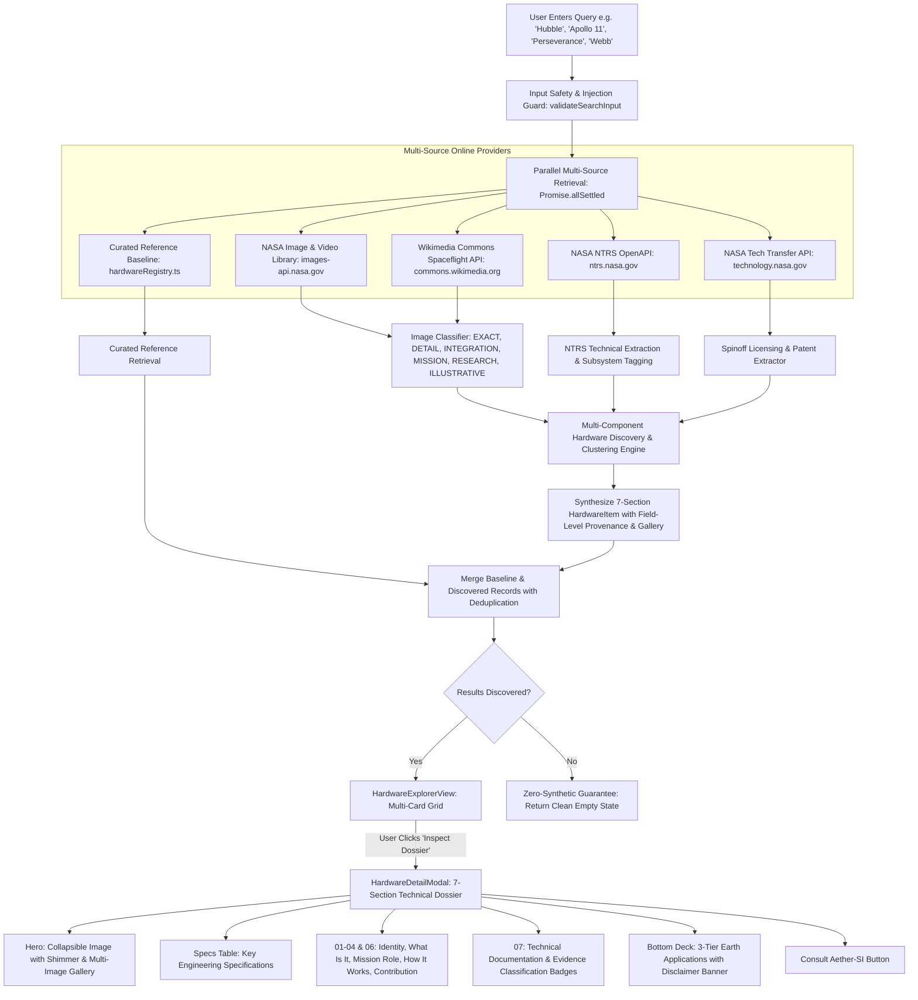

# NASA Hardware Explorer & Earth Applications Architecture

## 1. System Overview & Mission
The **NASA Hardware Explorer & Earth Applications** module is the dedicated third tab in the FLAME // FREEFALL research platform. It acts as an engineering bridge between NASA spaceflight hardware and useful technology transfers on Earth.

In **Phase 17 & 17.1**, this module was upgraded into a **live, multi-source online research-driven discovery platform** with wider-web image fallback, multi-image gallery switcher, collapsible zero-empty-box rendering, and rigorous scientific accuracy classification. Rather than being limited to a static registry, the platform queries official online NASA repositories and the Wikimedia Spaceflight Commons archive to discover spaceflight hardware, scientific instruments, and flight apparatus for any mission or experiment.

---

## 2. Component Hierarchy & Flow Diagram

---

## 3. Independent Live Data Connectors (`server.ts`)

### A. NASA Image and Video Library (`fetchNasaImagesDetailed`)
- Primary Endpoint: `GET https://images-api.nasa.gov/search?q={query}&media_type=image&page=1&page_size=16`
- Role: Primary repository for authentic NASA photographs, flight units in cleanrooms, and astronaut surface EVA records.
- Classifies images with granular confidence ratings:
  - `EXACT_HARDWARE_IMAGE`: The photo explicitly depicts the flight unit or flight spare.
  - `HARDWARE_DETAIL_IMAGE`: A component, detector, cryocooler, optical prism, or pump subsystem.
  - `MISSION_INTEGRATION_IMAGE`: The hardware unit integrated inside the rover turret, chassis, or rack.
  - `MISSION_RELATED_IMAGE`: Launch, rover traversal, planetary landing site context.
  - `ILLUSTRATIVE_IMAGE`: Official concept schematic or CAD visualization.

### B. Wikimedia Commons Spaceflight Archive (`fetchWikimediaSpaceflightImages`)
- Primary Endpoint: `GET https://commons.wikimedia.org/w/api.php?action=query&generator=search&gsrsearch={query}+spaceflight+OR+NASA&prop=imageinfo`
- Role: Wider-web image fallback providing high-resolution photographs with licensing metadata and author credit.
- Assigns `EXTERNAL_RESEARCH_IMAGE` or `HARDWARE_DETAIL_IMAGE`.

### C. NASA Technical Reports Server OpenAPI (`fetchNasaNtrsCitations`)
- Primary Endpoint: `GET https://ntrs.nasa.gov/api/citations/search?q={query}&page.size=8`
- Role: Discovers technical reports, instrument handbooks, and operational flight evaluations.
- Preserves NTRS Accession ID, author organizations, abstracts, and direct citation links. Supports tagging individual citations as `SUBSYSTEM_DOCUMENTATION`.

### D. NASA Technology Transfer & Spinoff API (`fetchNasaTechTransfer`)
- Endpoints: `GET https://technology.nasa.gov/api/api/spinoff/{keywords}` and `patent/{keywords}`
- Role: Queries authentic NASA Technology Transfer database, strips HTML tags, and retrieves verified commercial case IDs and patent numbers.

---

## 4. UI Invariant: Zero-Placeholder Collapsible Container Rendering

A major UX requirement of Phase 17.1 was eliminating empty or broken rectangular image boxes:

1. **`HardwareCard.tsx`**:
   - Evaluates `const hasImage = !imageError && Boolean(hardware.image?.thumbnailUrl);`.
   - When `hasImage` is `false`, the 192px image container is omitted from rendering.
   - Header badges (Record State, Category, Mission, Acronym) relocate to a compact top bar within the card body.
   - The card takes up its natural height without any grey placeholder bar.
2. **`HardwareDetailModal.tsx`**:
   - Evaluates `hasImage`.
   - When `false`, the modal completely skips rendering the image container, allowing Section 05 (Engineering Specifications) and Identity to start immediately at the top of the left column.
   - When multiple images exist (`hardware.images.length > 1`), an interactive thumbnail gallery switcher is rendered.
   - Asynchronous image loading displays an animated shimmer rather than layout jumps.

---

## 5. Security & Rate-Limiting Controls
- Input Validation: Queries undergo regex cleansing via `validateSearchInput` rejecting SQLi, script tags, control characters, and buffer overflows (> 250 chars).
- Sliding-Window Rate Budget: SlidingWindowRateBudget restricts requests to 450 requests per 15 minutes (under the 500 req limit).
- Concurrency Limiter: Caps simultaneous in-flight connections to upstream NASA endpoints to 3 concurrent requests.
- In-Flight Deduplicator: Coalesces identical concurrent searches into a single shared Promise.
- Bounded LRU Cache: BoundedTtlCache holds 200 items with a 15-minute TTL.
